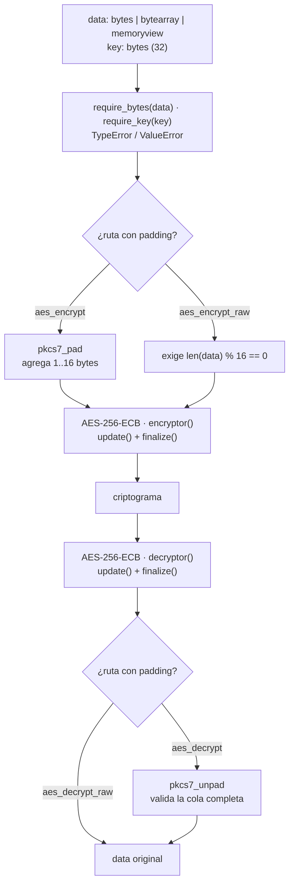

# AES-256-ECB — módulo de Bruno

Componente AES del trabajo práctico basado en *AES-RC4 Encryption Technique to
Improve File Security* (Atikah et al., 2019).

Este repositorio contiene **solo la parte de Bruno**: cifrado y descifrado
AES-256-ECB sobre `bytes`, con padding PKCS#7 y una ruta sin padding para los
experimentos de Avalanche Effect. RC4 (José) y la medición del efecto avalancha
(Diego) viven en sus propios módulos.

## Estado

Completo y verificado: **95 tests pasando**. Incluye vectores oficiales
FIPS-197 y NIST SP 800-38A, prueba de round-trip con archivos binarios reales y
verificación de integridad por SHA-256.

## Requisitos

| Requisito | Versión | Nota |
|---|---|---|
| Python | ≥ 3.9 (probado en 3.13) | sin entorno conda |
| `cryptography` | probado con 45.0.7 | única dependencia de runtime |
| `pytest` | probado con 9.2.0 | solo para correr los tests |

```bash
python -m pip install cryptography pytest
```

## Flujo



Las dos rutas comparten el mismo núcleo: `aes_encrypt` agrega padding antes de
cifrar y `aes_decrypt` lo quita después de descifrar. `*_raw` no toca el
padding y existe solo para comparar cifradores con el mismo denominador de bits.

## Interfaz pública

```python
from aes256 import (
    aes_encrypt, aes_decrypt,
    aes_encrypt_raw, aes_decrypt_raw,
    generate_key,
)

ct = aes_encrypt(data, key)          # PKCS#7, cualquier longitud
pt = aes_decrypt(ct, key)            # ValueError si el relleno no es válido
ct = aes_encrypt_raw(data, key)      # sin padding, len(data) % 16 == 0
pt = aes_decrypt_raw(ct, key)        # ídem, para experimentos
key = generate_key()                 # 32 bytes de os.urandom
```

`key` debe medir **32 bytes** (AES-256). Todo entra y sale como `bytes`.

| Situación | Excepción |
|---|---|
| `data` o `key` de tipo incorrecto (`str`, `int`, …) | `TypeError` |
| Clave distinta de 32 bytes | `ValueError` |
| `*_raw` con `len % 16 != 0` | `ValueError` |
| Criptograma truncado | `ValueError` |
| Relleno PKCS#7 inválido (clave incorrecta o datos corruptos) | `ValueError` |

Tamaños: `len(aes_encrypt(x)) == 16 * (len(x) // 16 + 1)`. Siempre se agrega al
menos un byte de relleno; si `len(x)` ya es múltiplo de 16, se agrega un bloque
completo.

## Estructura

```
aes256.py            # núcleo: AES-256-ECB y API pública
padding.py           # PKCS#7 (pad / unpad validado)
validation.py        # tipos y largo de clave
scripts/file_cli.py  # cifra/descifra archivos y reporta tamaños + SHA-256
tests/               # pytest: vectores, API, raw y CLI
docs/DECISIONS.md    # decisiones, límites y evidencia de ejecución
```

## Uso

### Desde código

```python
from aes256 import aes_encrypt, aes_decrypt, generate_key

key = generate_key()
ct = aes_encrypt(b"hola mundo", key)
assert aes_decrypt(ct, key) == b"hola mundo"
```

### Con archivos

```bash
python scripts/file_cli.py generate-key
python scripts/file_cli.py encrypt entrada.bin salida.enc --key-hex <64 hex>
python scripts/file_cli.py decrypt salida.enc recuperado.bin --key-hex <64 hex>
```

Salida real con un archivo aleatorio de 1.000.000 bytes:

```
archivo          /tmp/opencode/aescli/orig.bin
tamano_origen    1000000
tamano_destino   1000016
sha256_origen    9b383b0167678478428c5e9300573389d77be7f54a952956ec5886f2b6009b6c
sha256_destino   6eb91643f04d53fb8cb6b01f63e738e1a314ac916dd0fc8057b4d7e71646a4ed

archivo          /tmp/opencode/aescli/orig.enc
tamano_origen    1000016
tamano_destino   1000000
sha256_origen    6eb91643f04d53fb8cb6b01f63e738e1a314ac916dd0fc8057b4d7e71646a4ed
sha256_destino   9b383b0167678478428c5e9300573389d77be7f54a952956ec5886f2b6009b6c
```

Los hashes se cruzan: lo que se cifró es exactamente lo que se descifró. El
overhead es de 16 bytes (0,0016 %).

## Tests

```bash
python -m pytest -q          # 95 passed
python -m pytest tests/test_aes_vectors.py -q   # solo vectores oficiales
```

| Archivo | Qué cubre |
|---|---|
| `test_padding.py` | PKCS#7: bordes y relleno inválido |
| `test_aes_vectors.py` | FIPS-197 C.3 y NIST SP 800-38A F.1.5 |
| `test_api.py` | round-trip 0–1 MB, determinismo, errores |
| `test_raw.py` | ruta sin padding y coherencia entre capas |
| `test_file_cli.py` | reporte de tamaños/hashes y `main` |

## Integración con el equipo

- **Diego (Avalanche Effect):** comparar `cipher1` y `cipher2` con
  `calculate_avalanche(c1, c2)`. Para cambios de clave sobre bloques completos,
  `aes_encrypt_raw` garantiza el mismo tamaño de entrada que RC4.
- **José (RC4):** contrato previsto `rc4_encrypt(data, key)` /
  `rc4_decrypt(data, key)`. Cuando exista, la cascada se agrega en `hybrid.py`
  sin tocar `aes256.py`:
  ```python
  rc4_encrypt(aes_encrypt(data, aes_key), rc4_key)   # cifrado
  aes_decrypt(rc4_decrypt(data, rc4_key), aes_key)   # descifrado
  ```

## Advertencia

ECB se usa con fines **exclusivamente académicos**: es determinista, revela
patrones de bloques repetidos y no autentica. No usar para proteger datos
reales. Los detalles y la justificación están en `docs/DECISIONS.md`.
