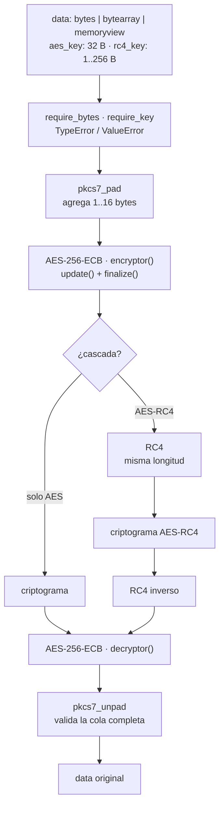

# AES-256 y cascada AES-RC4

Trabajo práctico basado en *AES-RC4 Encryption Technique to Improve File
Security* (Atikah et al., 2019).

Este repositorio contiene la implementación del equipo: cifrado y descifrado
AES-256-ECB sobre `bytes`, con padding PKCS#7, una ruta sin padding para los
experimentos de Avalanche Effect y la cascada AES-RC4. Los módulos de RC4 e
integridad se usan sin modificarlos, y la medición del efecto avalancha
corresponde a otra parte del trabajo.

## Estado

Completo y verificado: **186 tests pasando**. Incluye vectores oficiales
FIPS-197 y NIST SP 800-38A para AES, vectores clásicos para RC4, round-trip con
archivos binarios reales, cascada AES-RC4 y verificación de integridad por
SHA-256 y BER.

## Requisitos

| Requisito | Versión | Nota |
|---|---|---|
| Python | ≥ 3.9 (probado en 3.13) | sin entorno conda |
| `cryptography` | probado con 45.0.7 | única dependencia de runtime |
| `pytest` | probado con 9.2.0 | solo para correr los tests |

```bash
python -m pip install cryptography pytest
```

## Flujo



El núcleo es siempre AES: `aes_encrypt` agrega padding antes de cifrar y
`aes_decrypt` lo quita después de descifrar. La cascada agrega RC4 **después**
de AES al cifrar y **antes** de AES al descifrar, así que el padding viaja
dentro de RC4. La ruta `*_raw` es la misma línea sin el paso de padding y exige
que `len(data)` sea múltiplo de 16.

## Interfaz pública

```python
from aes256 import (
    aes_encrypt, aes_decrypt,
    aes_encrypt_raw, aes_decrypt_raw,
    generate_key,
)
from hybrid import hybrid_encrypt, hybrid_decrypt, generate_rc4_key
from rc4 import rc4_encrypt, rc4_decrypt

ct = aes_encrypt(data, key)              # PKCS#7, cualquier longitud
pt = aes_decrypt(ct, key)                # ValueError si el relleno no es válido
ct = aes_encrypt_raw(data, key)          # sin padding, len(data) % 16 == 0
pt = aes_decrypt_raw(ct, key)            # ídem, para experimentos

ct = hybrid_encrypt(data, aes_key, rc4_key)   # AES-256 y luego RC4
pt = hybrid_decrypt(ct, aes_key, rc4_key)     # RC4 y luego AES

ct = rc4_encrypt(data, rc4_key)          # misma longitud, sin padding
pt = rc4_decrypt(ct, rc4_key)            # RC4 es simétrico

key = generate_key()                     # 32 bytes de os.urandom
rc4_key = generate_rc4_key(16)           # 1 a 256 bytes de os.urandom
```

Todo entra y sale como `bytes`. La clave AES debe medir **32 bytes**; la de RC4,
entre **1 y 256**.

| Situación | Excepción |
|---|---|
| `data` o `key` de tipo incorrecto (`str`, `int`, …) | `TypeError` |
| Clave AES distinta de 32 bytes | `ValueError` |
| Clave RC4 fuera de 1–256 bytes | `ValueError` |
| `*_raw` o criptograma con `len % 16 != 0` | `ValueError` |
| Criptograma truncado | `ValueError` |
| Relleno PKCS#7 inválido (clave incorrecta o datos corruptos) | `ValueError` |

Ese contrato es el de `aes256.py` y `hybrid.py`. `rc4.py` es más permisivo con la
clave: codifica un `str` en UTF-8 y convierte un `int` con `bytes(key)`;
`hybrid.py` lo restringe a `bytes` de 1 a 256.

Tamaños:

| Operación | Longitud de salida |
|---|---|
| `aes_encrypt` / `hybrid_encrypt` | `16 * (n // 16 + 1)` |
| `aes_encrypt_raw` | `n` (exige `n % 16 == 0`) |
| RC4 | `n` |

Siempre se agrega al menos un byte de relleno; si `n` ya es múltiplo de 16, se
agrega un bloque completo. RC4 no cambia longitudes, por eso el híbrido mide lo
mismo que AES.

## Estructura

```
aes256.py            # núcleo: AES-256-ECB y API pública
padding.py           # PKCS#7 (pad / unpad validado)
validation.py        # tipos y largo de clave
hybrid.py            # cascada AES-RC4; compone los módulos existentes
rc4.py               # RC4: KSA + PRGA + XOR
integrity.py         # BER, SHA-256 y comparación exacta
scripts/file_cli.py  # cifra/descifra archivos y reporta tamaños + SHA-256
tests/               # pytest: vectores, API, raw, cascada, RC4, integridad y CLI
docs/DECISIONS.md    # decisiones, límites y evidencia de ejecución
```

## Uso

### Desde código

```python
from aes256 import aes_encrypt, aes_decrypt, generate_key

key = generate_key()
ct = aes_encrypt(b"hola mundo", key)
assert aes_decrypt(ct, key) == b"hola mundo"
```

```python
from hybrid import hybrid_encrypt, hybrid_decrypt, generate_rc4_key

aes_key = generate_key()
rc4_key = generate_rc4_key(16)
ct = hybrid_encrypt(b"hola mundo", aes_key, rc4_key)
assert hybrid_decrypt(ct, aes_key, rc4_key) == b"hola mundo"
```

### Con archivos

```bash
python scripts/file_cli.py generate-key
python scripts/file_cli.py generate-rc4-key --size 16

python scripts/file_cli.py encrypt  entrada.bin salida.aes --key-hex <64 hex>
python scripts/file_cli.py rc4-encrypt entrada.bin salida.rc4 --key-hex <32 hex>
python scripts/file_cli.py rc4-decrypt salida.rc4 recuperado.bin --key-hex <32 hex>
python scripts/file_cli.py hybrid-encrypt entrada.bin salida.hyb \
    --aes-key-hex <64 hex> --rc4-key-hex <32 hex>

python scripts/file_cli.py hybrid-decrypt salida.hyb recuperado.bin \
    --aes-key-hex <64 hex> --rc4-key-hex <32 hex>
```

Salida real con un archivo aleatorio de 1.000.000 bytes (cascada AES-RC4):

```
archivo: /tmp/opencode/readme/orig.bin
tamano_origen: 1000000
tamano_destino: 1000016
sha256_origen: 30aa7a92514af35d7fe71699db7335702d59c2f8eef70325ec7e33b4af5c4116
sha256_destino: f6341c8493ffbed26c1a665a2ca8ad79c46076fc303bba95f9f0a91027f74528
```

```
archivo: /tmp/opencode/readme/orig.hyb
tamano_origen: 1000016
tamano_destino: 1000000
sha256_origen: f6341c8493ffbed26c1a665a2ca8ad79c46076fc303bba95f9f0a91027f74528
sha256_destino: 30aa7a92514af35d7fe71699db7335702d59c2f8eef70325ec7e33b4af5c4116
```

Los hashes se cruzan y `cmp` confirma recuperación exacta; `check_integrity`
devuelve `ber = 0.0`, `sha256_match = True` e `identical = True`.

Tamaños de archivo, listos para la Tabla II del informe:

| Archivo | Original | AES | RC4 | AES-RC4 |
|---|---|---|---|---|
| `orig.bin` | 1.000.000 | 1.000.016 | 1.000.000 | 1.000.016 |

## Tests

```bash
python -m pytest -q                                  # 186 passed
python -m pytest tests/test_aes_vectors.py -q        # solo vectores AES
python -m pytest tests/test_hybrid.py -q             # solo la cascada
```

| Archivo | Qué cubre |
|---|---|
| `test_padding.py` | PKCS#7: bordes, relleno inválido y `block_size` |
| `test_aes_vectors.py` | FIPS-197 C.3 y NIST SP 800-38A F.1.5 |
| `test_api.py` | round-trip 0–1 MB, determinismo, errores |
| `test_raw.py` | ruta sin padding y coherencia entre capas |
| `test_rc4_vectors.py` | vectores clásicos de RC4 (compuerta de integración) |
| `test_integrity.py` | Hamming, BER y `check_integrity` |
| `test_hybrid.py` | orden de la cascada, tamaños, errores e invariantes |
| `test_file_cli.py` | reporte de tamaños/hashes y todos los subcomandos |

## Integración con el equipo

**Avalanche Effect.** Con una sola clave modificada, la cascada hereda
el efecto avalancha del cifrador cuya clave cambió; no lo amplifica:

| Bit invertido | Relación | Medición (2.000 B) |
|---|---|---|
| Clave AES, RC4 fija | `dH(híbrido) == dH(AES)`, **exacta** | 8.039 == 8.039 |
| Clave RC4, AES fija | aproximada, no exacta | 8.208 frente a 8.141 |

La primera es exacta porque RC4 es `C = X ⊕ keystream` y el XOR con una
constante preserva la distancia de Hamming. Por eso, si la fila "AES-RC4" de la
Tabla III se mide invirtiendo la clave AES, la columna **duplica** la de AES.
Conviene invertir un bit de la clave RC4 y discutir que la cascada no mejora la
difusión, solo la conserva. `integrity.ber(c1, c2) * 100` es exactamente la
ecuación (1) del enunciado, siempre que `|c1| == |c2|`.

**RC4 e integridad.** `rc4.py` reproduce los tres vectores clásicos y se usa
sin modificaciones. Una advertencia para la revisión del módulo: `_check_key`
hace `bytes(key)`, así que `rc4_encrypt(data, 32)` acepta un `int` y usa una
clave de 32 ceros en silencio. `hybrid.py` lo bloquea en su frontera exigiendo
`bytes`, pero el arreglo de fondo corresponde a `rc4.py`.

## Advertencia

ECB se usa con fines **exclusivamente académicos**: es determinista, revela
patrones de bloques repetidos y no autentica. La cascada tampoco autentica: una
clave incorrecta se detecta solo de forma probabilística al validar el padding.
No usar nada de esto para proteger datos reales. Los detalles y la
justificación están en `docs/DECISIONS.md`.
